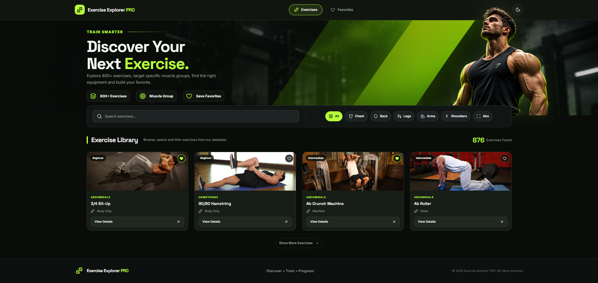

# 🏋️ Exercise Explorer PRO

Modern, responsive fitness exercise explorer built with HTML, CSS and Vanilla JavaScript.

### 🌐 Live Demo

[View Live Demo](https://johnyisbackk.github.io/js-exercise-explorer/)

### 📸 Preview

## ✨ Features

- 800+ exercises from Free Exercise DB
- Fetch API with async/await
- Real-time exercise search
- Muscle group filtering
- Favorites with localStorage
- Exercise details modal
- Step-by-step exercise instructions
- Show More Exercises functionality
- Dark / Light theme
- Fully responsive design

## 🛠️ Technologies

- HTML5
- CSS3
- Vanilla JavaScript
- Fetch API
- LocalStorage
- Lucide Icons

## 📦 Data Source

Exercise data and images provided by
[Free Exercise DB](https://github.com/yuhonas/free-exercise-db).

## 👨‍💻 Author

**Samuel Jahn**

- [Portfolio](https://samueljahn.sk)
- [GitHub](https://github.com/JohnyIsBackk)
- [Online CV](https://johnyisbackk.github.io/frontend-developer-cv/)

## 📄 License

MIT License.
